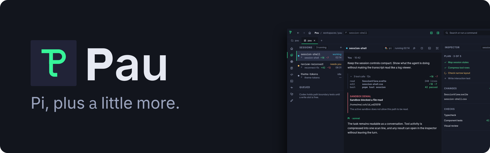

<p align="center"></p>

# Pau

Pau is a local-first desktop and web application for running coding-agent
sessions across projects. Pi is the primary agent. Claude Code, Codex, and
Antigravity can be added through process adapters.

The name references
[xkcd 1292, “Pi vs. Tau”](https://www.explainxkcd.com/wiki/index.php/1292:_Pi_vs._Tau).

The application is planned around:

- Tauri 2 for the desktop shell
- SvelteKit for the interface
- Axum for the local API, WebSocket event stream, and web server
- Rust process and PTY supervision
- Pi's RPC protocol for structured session control
- Neovim's embedded RPC UI, with CodeMirror as a lightweight editor

The repository contains the desktop application, a remote web application
scaffold, documentation site, shared packages, and Rust services.
[SPEC.md](dev/SPEC.md) describes the product, [PLAN.md](dev/PLAN.md) the
architecture, and [ROADMAP.md](dev/ROADMAP.md) how work is split into tasks.

## Development environment

### macOS

Install the toolchain from vendor installers and Homebrew. The project does not
use the Nix shell or direnv on macOS.

- Xcode Command Line Tools: `xcode-select --install`
- Rust stable through [rustup](https://rustup.rs)
- Node.js 24 and pnpm: `brew install node@24 pnpm`. pnpm switches to the
  version pinned in `package.json` on its own.
- Optional: `brew install lychee` for the website link check

Keep local settings in a `.env` file at the repository root. Start from the
example:

```sh
cp .env.example .env
```

The desktop app, the browser development servers, and the macOS release script
read `.env`. Variables already set in your shell take precedence.
[Signed macOS builds](dev/macos-signing.md) covers the signing and notarization
settings.

### NixOS

The Nix flake provides Rust, Node.js, pnpm, SQLite, Neovim, and the native
libraries Tauri needs on x86-64 and ARM64 Linux. Enter it directly:

```sh
nix develop
```

For automatic activation, run `direnv allow`. The `.envrc` loads the flake and
then `.env` if it exists. On macOS it only loads `.env`.

### Checks

Install dependencies and run the gate from the repository root:

```sh
pnpm install
pnpm gate
```

The gate checks formatting, types, lints, and generated code, then runs the
Rust and TypeScript tests, including the browser tests. CI runs the same
command. `pnpm gate:rust` and `pnpm gate:ts` run each half on its own.

Build the documentation site and Pagefind index:

```sh
pnpm build:website
```

Start the component workbench for shared UI development:

```sh
pnpm dev:ui
```

Run its browser tests or build the static workbench:

```sh
pnpm test:ui
pnpm build:ui
```

When a Rust wire type changes, update the checked TypeScript contract:

```sh
pnpm generate:protocol
```

## Pi installation

Pau discovers Pi from a configured executable path or `PATH`. It supports Pi
0.87.1 and later, is tested with Pi 1.0.0, and warns when it runs a newer
release. Install Pi globally with npm if `pi --version` does not report a
supported release:

```sh
npm install --global @earendil-works/pi-coding-agent
pi --version
```

Discovery checks the version without starting a session. It reports Pi's user
configuration under `PI_CODING_AGENT_DIR` or `~/.pi/agent`, project
configuration under `<workspace>/.pi`, and session storage under
`PI_CODING_AGENT_SESSION_DIR` or the user configuration directory.

## Run the local application

For browser development, set `PAU_API_TOKEN` in `.env` to the output of
`openssl rand -hex 32`. Then start the local API and the web app in separate
terminals:

```sh
cargo run -p pau-server
pnpm dev:desktop:browser
```

The development server authenticates and forwards `/api` requests to the local
API at `127.0.0.1:3001`. All endpoints reject requests without the launch
token. Workspace registrations are stored in the local Pau data directory. Set
`PAU_DATABASE_PATH` to use another SQLite file during development.

To run the desktop app, use the Tauri development command:

```sh
pnpm dev:desktop
```

The remote web application remains a separate scaffold. Run its development
server with:

```sh
pnpm dev:web
```

Tauri generates a new API token, starts the API on an unused loopback port, and
passes the token to its webview. It stops the API when the app exits. The
desktop app loads static assets built by `apps/desktop`; the same frontend runs
in development browser mode. `apps/web` remains a separate scaffold for the
remote application. API logs record authentication failures without recording
supplied credentials.

## Product principles

- Keep agent processes visible and interruptible.
- Preserve each agent's native session format instead of inventing a second
  transcript format.
- Put protocol-specific behavior behind small adapters.
- Use the same backend and frontend in desktop and browser modes.
- Treat local command execution as privileged access, especially in browser
  mode.
- Ship useful vertical slices before adding dashboards, agent councils, or
  workflow builders.

## License

Pau is available under either the MIT License or the Apache License 2.0.
